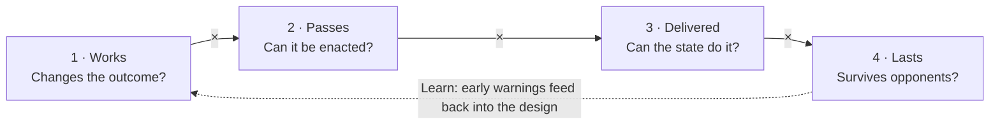

# Statecraft

**A think-tank-grade statecraft advisor skill for Claude, specialised in the United States.** You bring a problem a country faces; it builds a strategy that can actually be passed, delivered and kept.

> Ideas are cheap. Execution under real constraints is everything.

| | |
|---|---|
| **Current version** | v2.0 (see [CHANGELOG.md](CHANGELOG.md)) |
| **Skill file** | [`statecraft/SKILL.md`](statecraft/SKILL.md), about 9,800 words |
| **Test cases** | [`statecraft/evals/`](statecraft/evals/): 3 cases in the `claude plugin eval` layout |
| **Test results** | [`test-runs/iteration-1/`](test-runs/iteration-1/): v1 vs plain Claude |

## Install

- **Claude (web, desktop, mobile):** add `statecraft/` as a custom skill, zipped if your upload asks for it. After that it loads on its own whenever a conversation needs it.
- **Claude Code:** copy the folder to `~/.claude/skills/statecraft/` for every project, or to `.claude/skills/statecraft/` inside a single project.
- **OpenCode and other agents:** copy `statecraft/SKILL.md` to wherever your setup loads skills from.

To force it on, start a message with `/statecraft`.

## Repository layout

```
statecraft/
├── README.md               this guide
├── CHANGELOG.md            what changed between versions, and why
├── statecraft/
│   ├── SKILL.md            the skill itself
│   └── evals/              test prompts and graders
└── test-runs/
    └── iteration-1/        v1 vs plain Claude: outputs, grades, benchmark,
                            editor's notes, review.html (side-by-side viewer)
```

Tags `v1.0` and `v2.0` mark each version. To see exactly what changed between them, run `git diff v1.0 v2.0 -- statecraft/SKILL.md`.

---

# The Complete Guide

## What statecraft is

Statecraft is a Claude skill that works like a think tank and a senior advisor to a head of government. You bring a problem a country faces; it builds a strategy that can actually be passed, delivered and kept.

Its core belief: **ideas are cheap, execution is everything.** Most policy writing spends its energy on *what* should be done. Statecraft spends it on the harder question: how to make it happen, starting from where the country actually is.

It specialises in the United States, with a deep and critical model of how American power really works. It still handles any country, across six kinds of problem: domestic policy, geopolitics, military strategy, AI and tech-industrial strategy, country turnarounds and crisis response.

**What it is not.** It isn't a pundit, a partisan, or a history explainer. It won't decide your values for you. It won't design repression, election manipulation or weapons detail.

**How it's built.** It is one skill file of about 9,800 words, loaded only when a conversation needs it. Inside: a thinking method, six working modes, a dossier template, a deep America section, six domain playbooks, 19 frameworks, about 40 historical cases and a list of thinking traps.

## The core engine: four gates

Every policy must pass four gates, and its odds of success are roughly the four probabilities multiplied together. The weakest gate dominates, so the skill's first job is to find which gate is the bottleneck.



One weak gate drags the whole product down, which is why the skill hunts for the bottleneck before polishing the idea.

| Gate | The question | What it examines |
| --- | --- | --- |
| 1. Works | If implemented, does it actually change the outcome? | Root cause vs symptom, how people react and game it, knock-on effects, whether it's big enough to matter, cost |
| 2. Passes | Can the leader get the authority to enact it? | The legal route, who can block it, vote counts, interest groups, public opinion, timing, narrative |
| 3. Delivered | Can the government machinery actually carry it out? | Which agency does what on Monday, staff and IT, procurement, realistic timelines, pilot-to-scale drop-off |
| 4. Lasts | Does it survive opponents, elections and time? | Who will defend it, lock-in, the opposition's routes to kill it, market and foreign reaction |
| Loop: Learns | Will we know fast if it's failing? | Early-warning indicators, pre-agreed tripwires, kill criteria |

**Why this matters.** Most debates pour 90% of their effort into gate 1. A brilliant wealth tax that never survives Congress and the courts is worth zero. Real strategy puts its effort where the bottleneck is: usually *Passes* or *Lasts* in polarised democracies, *Delivered* in weak states, *Works* in ideological projects.

**The odds line.** For any serious plan the skill writes one line like this: *Works ~70% · Passes ~25% · Delivered ~60% · Lasts ~50% → roughly 5%. Binding gate: Passes.* The numbers are deliberately coarse: rounded to the nearest 5%, "under 5%" rather than a fake tiny figure, or low/medium/high bands. Their job is to force honesty about where the plan is weak and to show which design choice moves which gate. In foreign policy, "Passes" also covers what allies, adversaries and markets will permit.

## The bedrock truths

The skill reasons upward from eleven near-laws of politics. Almost every policy failure in history breaks at least one of them.

1. **Countries don't act; people with specific powers do.** "America should…" is not a plan until you name whose chair you're in.
2. **Every policy redistributes something**: money, status, power, risk or time. There are always losers.
3. **Concentrated losers beat diffuse winners.** A small group losing a lot organises; a big group gaining a little doesn't notice.
4. **The system adapts.** People, firms, markets and adversaries respond, so every policy is a hypothesis.
5. **Implementation is a chain of probabilities.** Seventy sign-offs at 99% each give you a coin flip.
6. **Costs arrive before benefits; elections arrive on schedule.** If the dip outlasts your runway, the reform dies in it.
7. **Political capital is finite.** It's highest at the start and after crises, and every fight spends it.
8. **Legitimacy is load-bearing.** Policies seen as fair survive; imposed ones get sabotaged.
9. **Credibility is priced instantly** by markets, allies and adversaries.
10. **The state can only manage what it can see, and every target gets gamed.**
11. **Policies create their own politics.** Once people receive a benefit, they defend it, so design for defenders.

## How it works a problem

The skill follows the natural order of a serious strategist's mind. It isn't a form: a quick answer touches three steps in a few paragraphs, while a full dossier walks all eleven.

1. **Reframe.** Split the problem into its real versions, pick one, and define success as a metric, a target and a date.
2. **Fix the seat and the clock.** Whose chair, what powers, how long until the next election or deadline, how much capital and money.
3. **Ground it in reality.** Look up current data, laws and who holds power; learn what was tried before and why it ended.
4. **Diagnose the mechanics.** Root causes, the loops that keep the problem in place, and who profits from the status quo.
5. **Map the power.** Every actor's power, stance, intensity and price; every veto point; the path to a winning coalition.
6. **Generate real options.** Genuinely different routes, including an indirect one, each scored at all four gates.
7. **Design the integrated strategy.** Mechanism, political path, delivery and durability built together, in a deliberate sequence.
8. **Wargame it.** Each actor's best move against you and your counter, two or three moves deep, at 3 months, 3 years and 10 years.
9. **Pre-mortem and red-team it.** "It failed. Why?" Plus answers to the three classic attacks: it will backfire, it won't work, it will endanger something precious.
10. **Instrument it.** Leading indicators, tripwires, kill criteria and a first-100-days plan.
11. **Calibrate.** Separate what's known, assumed and judged, and say what would change the recommendation.

Two checks run through the whole sequence. **Use what's already in motion:** before proposing anything new, the skill lists money already appropriated but unspent, powers on the books but unused, programmes already created (including the other side's) and deadlines that will force a vote anyway. Steering existing machinery is usually faster and more durable. **Find the non-obvious moves:** after the obvious strategy, it hunts for two or three moves a smart opponent wouldn't expect, such as a trade each side can sell at home, using the opponent's own programme, or splitting a popular item from a contested one. It also checks that every target it sets actually binds against where things were already heading.

## The cabinet of advisors

Inside, the skill runs every serious problem past a small cabinet. Each advisor asks one question and catches one classic mistake. Only the ones a problem needs are called in. When two disagree, the skill shows you the disagreement in plain words instead of averaging it away, because that tension is usually where the real decision lives.

| Advisor | The question they ask | The mistake they catch |
| --- | --- | --- |
| The Economist | Does it change behaviour at scale, and what does it really cost? | Wishful mechanisms |
| The Whip | Where are the votes, and what does each swing actor need? | Plans that can't pass |
| The Civil Service chief | Who does this on Monday morning, with what staff and systems? | Delivery fantasy |
| The Historian | Who tried this before, and what happened? | Repeating past failures |
| The Geostrategist | How will foreign powers and bond markets react? | Domestic tunnel vision |
| The Opposition Leader | What's the strongest case against, and how will I attack it? | The echo chamber |
| The Citizen at the Counter | What does this feel like on the receiving end? | Abstraction |
| The Long View | What does this lock in for 20 years? | Short-termism |

For specialist problems it adds a General (military), a Technologist (AI and industry) or a Central Banker (financial crises). The cabinet is a thinking device; it never appears in the output as a cast of characters.

## The six modes

The skill reads what you're asking for and moves between six working modes on its own. You never have to name a mode, but you can.

| Mode | What it does | Use it when | Example opener |
| --- | --- | --- | --- |
| Counsel | Direct answer, reasoning, the bottleneck gate, a challenge if needed, one sharp question back | You want advice or to think out loud | "Is a wealth tax even the right tool?" |
| Country Brief | Assesses a country's position, ranks 3–5 priorities, sets the order and what *not* to do | You want the big picture for a country | "What does Japan actually need to do?" |
| Strategy Dossier | The full build, written up as a document you keep and refine | A real plan has formed | "Okay, write up the full strategy." |
| War Room | A turn-by-turn simulation: you're the leader, it plays everyone else | You want to test a plan against reality | "War Room: I'm the President, goal is X." |
| Red Team | Attacks your plan gate by gate, then ranks fixes | You already have a plan | "Red-team this plan: …" |
| Crisis Desk | Decisions in time slices: first 24 hours, first week, first month | Something just broke | "Crisis: a major bank just failed." |

**The first answer to a big question.** Ask "what should America do about X" and you get one integrated answer of roughly 1,500–3,000 words, not a dossier. The recommendation and first moves come in the opening paragraphs. Then come the seat, the strategy with owners and sequence, the non-obvious moves, the risks with tripwires, and your decisions. It ends with the fork question that would most change the plan, and an offer to build the dossier once you've picked a direction.

**War Room in detail.** It sets the starting position from real, current data. Each turn shows a status panel: political capital, approval, vote count, budget room, the key indicator, international temperature, open threats. Every other actor plays to win by its own incentives, and realistic shocks happen (a court ruling, a scandal, a market move). You get two to four options plus a free choice each turn, a debrief every few turns, and an after-action review at the end.

## The strategy dossier

The dossier is the written deliverable: what a government delivery unit would hand a head of government. It appears once you've engaged with a direction, or whenever you ask for the write-up ("write it up", "make the doc"). It never comes as the first reply to a broad question. Once it exists, the skill keeps updating the same dossier as your thinking evolves.

It's written for the leader's staff: plain language, no framework names or skill jargon, roughly 3,000–6,000 words, and every section must change a decision or it's cut. The chat reply that accompanies it stays to about 250 words (bottom line, your decisions, the biggest risk) and never repeats the document.

In Claude it's created as an editable doc you can keep, comment on, share and export. In Claude Code or OpenCode it's a Markdown file named like `dossier-usa-wealth-gap-2026-11-25.md`.

**What's inside.** Six core sections, every time:

1. **Cabinet Brief (one page)**: the bottom line, the strategy in a few sentences, your decisions, the biggest risk, the odds line, what to do this week.
2. **The Problem and the Target**: current data, the version being solved, root causes, cost of inaction, and success as a metric, baseline, target and date.
3. **The Seat, the Constraints and the Route**: your real powers, time, capital and money; limits; what's already in motion; the legal route for each measure.
4. **The Strategy and the Sequence**: the mechanism, the non-obvious moves, phases, owners, delivery, how losers are handled, the story for each audience.
5. **Risks and Tripwires**: failure stories, the opposition's best case, early warnings with pre-agreed responses, kill criteria, surviving a change of government.
6. **The First 100 Days**: concrete actions by week and month, with owners.

Plus sources. **Optional modules** appear only when they change a decision: a full power-map table, options scored side by side, a move-by-move wargame, precedents, a fuller dashboard, confidence and open questions.

## The America specialisation

America is the default country, and the skill's model of it is the deepest part of the file. When you say "America needs to…", it sits in the President's chair with the real Congress of that moment, which it looks up rather than assumes.

**The central insight.** The US system was deliberately built to make action hard, with more veto points than almost any democracy. So in America the bottleneck is usually *Passes* or *Lasts*, and *Delivered* is chronically underrated. Most American problems with known fixes elsewhere (health costs, transit costs, permitting) are stuck on institutions, not ideas.

**The routes to law, and how durable each is.**

| Route | What it takes | The catch |
| --- | --- | --- |
| Regular legislation | House majority + 60 Senate votes + signature | Most durable, hardest |
| Budget reconciliation | 51 Senate votes | Only taxes and spending; the next 51 can undo it |
| Must-pass bills | Riding on budgets, the annual defense bill, debt deals | Powerful but bargaining-heavy |
| Executive orders and rules | The President's signature; rules take a year or more | Next President reverses; courts read agency power narrowly |
| Federal money to states | Conditional grants and waivers | Results vary with each state's capacity and politics |
| State-first | Prove it in willing states, then go national | Slow but powerful; the ACA started in Massachusetts |

**The forces underneath.** Two-year House terms create a permanent campaign. Landmark laws pass in the narrow first year or two of unified government. Primaries punish compromise. Policies become identity-coded, so *who* proposes something often matters more than *what* it is. The Senate and Electoral College make coalition maths a state-by-state exercise.

**The capacity problem.** Much US social policy is delivered invisibly through the tax code, so beneficiaries don't see government's hand and don't defend it (the "submerged state"). Passing is not delivering: HealthCare.gov's launch, a $42bn broadband programme that took years to connect homes, California high-speed rail. The skill's design rule for America: automatic enrolment, existing payment rails, fewer clearance points. Before reaching for a new law, it exhausts the laws, money and authorities already on the books.

**What has lasted.** Benefits spread across many districts; national-security framing; contributory, universal design (Social Security, Medicare); left–right coalitions with unusual messengers. The skill is critical of the comfortable stories on both sides and maps the main foreign-policy schools fairly without picking one for you.

## The domain playbooks

Each domain changes the physics of a problem, so the skill carries a playbook for each and combines them when a problem crosses domains.

| Domain | What changes | Key ideas it brings |
| --- | --- | --- |
| Domestic policy | It's all redistribution politics | Who pays vs who gains; make benefits visible and costs gradual; plan for scoring and lawsuits from day one |
| Geopolitics | The other side is a strategic adversary, not a coalition to build | Interests before values; deterrence = capability × resolve × belief; alliances balance abandonment vs entrapment; every deal is also a domestic deal |
| Military and defense | National strategy and defense policy | Ends, ways, means; deterrence by denial vs punishment; industrial surge capacity; logistics; "how does this end?" first |
| AI and tech-industrial | A fast-moving stack: chips, energy, talent, models, adoption | Diffusion beats invention; pick a national position; industrial policy needs performance conditions; always check current facts |
| Country turnarounds | Everything is broken; you can't fix it all | Find the one binding constraint; stabilise, restructure, then build institutions; big bang vs gradual |
| Crisis response | Time is the enemy | Speed and scale; reversible moves; one honest voice; recognise losses fast; plan the exit on the way in |

Military work stays at strategy and policy level only: no weapons engineering, tactics or targeting.

## The library

The library is where the skill's "experience" lives: what makes it reason like someone who has watched many reforms win and die.

**19 frameworks**, each tagged with when it works and when it misleads. The most used: the implementation chain (Pressman & Wildavsky), policy windows (Kingdon), veto players (Tsebelis), concentrated vs diffuse interests (Olson, Wilson), policy feedback (Pierson, Patashnik), selectorate theory for any regime, two-level games (Putnam), Deliverology (Barber), growth diagnostics, Hirschman's three attacks on reform, *Seeing Like a State*, reference-class forecasting, the voltage effect, and Schelling on deterrence.

**About 40 historical cases**, each with the one lesson that transfers. A sample:

- **Thatcher and the miners**: she retreated in 1981, stockpiled coal for three years, then won. Don't fight until you can outlast them.
- **Indonesia's fuel subsidies**: cut in the honeymoon, as oil fell, paired with cash for the poor. Use windows and compensate visibly.
- **Macron's fuel tax**: regressive costs with no visible fairness triggered the gilets jaunes. Fairness is part of the mechanism.
- **The 2021 Child Tax Credit**: cut child poverty to a record low, then expired. Temporary programmes are designed to die.
- **Truss's mini-budget**: bond markets ended a government in 49 days. Markets are a veto player.
- **The Great Leap Forward**: punishing bad news blinded the state. Build channels for bad news.
- **US chip export controls**: they bought time and galvanised China's self-sufficiency. Judge denial by the gap over time.

The library primes the skill's pattern recognition; it isn't a quote bank. A case is cited only when it changes or sharpens the recommendation, and precedents found in fresh research beat the library's generic ones.

**13 thinking traps** it watches for in your reasoning and its own. They include treating a country as one actor, "do what Singapore did" without Singapore's conditions, right direction but trivial scale, and assuming nobody reacts.

## How it treats you

You are the principal; the skill is the advisor. It argues, models consequences and recommends. You decide, especially on values (growth vs equality, liberty vs security) and on how much risk to take.

**When you have a view**, it first states your view in its strongest form, then tests it against the four gates. If it holds, it builds on it. If it fails, it names exactly where (which gate, which actor, which evidence) and offers a better direction.

**At real forks**, it lays out the live options with its recommendation and asks which way you lean, instead of quietly deciding for you. Sometimes it asks for your hypothesis first, to sharpen your own judgment.

**It challenges when it matters, not for sport.** Triggers: factual errors, wishful mechanisms, ignored losers or veto players, unrealistic timelines, treating a country as one actor, values passed off as facts, goals that contradict each other. If a goal can't be done in the time available, it says so and gives you the best achievable version.

**It is politically neutral.** It builds the best strategy for any goal from any part of the spectrum with equal rigour, always shows the strongest case against, and tests the comfortable stories of both left and right against evidence.

**The statecraft lesson.** Substantive chat replies end with three to five sentences naming the principle at work, a historical echo, and sometimes a question to sit with. This is the one place frameworks and thinkers get named, because the point is to teach you. It appears once per turn, in the chat reply (never inside a dossier), and is skipped when there's no real lesson.

## Boundaries

Statecraft practises legitimate statecraft: winning arguments, coalitions, votes and results within constitutional and humane limits. It won't design repression of dissent or minorities, election manipulation, disinformation aimed at citizens, persecution, coups or ways around constitutional limits. On military questions it stays at strategy and policy level.

Analysing how authoritarian systems work, or how adversaries think, is fair game; understanding is not endorsement. When a request edges toward the line, it redirects to the legitimate version of the goal, and notes the evidence that coerced policies tend to fail gate 4.

## How to use it

**Turning it on.** Once installed, the skill loads itself whenever you ask what a country or leader should do, how to pass or execute a policy, or anything on geopolitics, defense, AI strategy, turnarounds or crises. To force it, start with `/statecraft`.

**What makes a great prompt.** You can be casual; it fills gaps and states its assumptions. Four things sharpen the answer most:

- **The seat**: "as the President", "as Senate majority leader", "as governor of Texas", "as Singapore's PM".
- **The version of the goal**: "the bottom half owning nothing" beats "the wealth gap".
- **The horizon**: "before the 2028 election", "over 10 years".
- **Your instinct**: "I think the answer is X, prove me wrong" gets you a steelman and a real test.

**Example sessions, one per mode.**

| Mode | Try saying | What you'll get |
| --- | --- | --- |
| Counsel | "Is a wealth tax even the right tool for America, or is housing the real lever?" | A direct answer, the bottleneck gate, a challenge, one question back |
| Country Brief | "What does the UK actually need to do over the next decade, and in what order?" | Position, 3–5 ranked priorities, the sequence, what not to touch |
| Strategy Dossier | "Let's go with the housing route. Write up the full strategy." | A full dossier as an editable doc |
| War Room | "War Room. I'm the President, January 2027. Goal: pass permitting reform." | A live simulation with a status panel and real opponents |
| Red Team | "Here's my plan to fix US healthcare costs: … tear it apart." | Gate-by-gate attack, pre-mortems, ranked fixes |
| Crisis Desk | "Crisis: China blockades Taiwan tomorrow. I'm the National Security Adviser." | A decision plan for the first 24 hours, first week and first month |

**A good rhythm for a big question.** Open in Counsel to reframe the problem and pick the seat. Push back on its reframe if you disagree. Once a direction feels right, ask for the dossier. Then War Room it, or Red Team your own dossier, and let it update the doc.

## Getting the most out of it

The skill gets better the harder you push it. These habits pull the most out of it and sharpen your own thinking at the same time.

- **Argue back.** Disagree with its reframe or its recommendation; it is built to defend, concede or update with reasons.
- **Ask for the bottleneck.** "Which gate is binding?" and "show me the odds line" cut straight to where a plan is weak.
- **Swap the seat.** Run the same problem as President, then governor, then movement leader. Seeing how the strategy changes is the fastest way to understand power.
- **Red-team its own work.** Ask it to attack the dossier it just wrote, or to play the opposition's strategist.
- **Keep one dossier per issue.** Return to it as events move and let it update the doc.
- **Collect the lessons.** The statecraft lessons add up to a personal curriculum in how power works.

**Pitfalls to avoid.** Don't read the odds line as a forecast; it is a tool for finding weak spots. Check the key current numbers it cites before relying on them, since politics moves fast. And remember it's an advisor, not an oracle: a long, confident chain of reasoning can still be wrong, which is exactly why it shows its sources and its assumptions.

**Beyond politics.** The four gates apply to any change effort: will it work, can you get buy-in, can your team deliver it, will it last? The same method works inside a company.

## Version history and testing

Version 1 was tested side by side against plain Claude on three prompts: America's wealth gap, Singapore's AI strategy and the US defense industrial base. It passed every objective check (100% vs 89%) and was clearly better at grounding plans in who actually holds power. It also wrote too much too early and leaned on its own template.

Version 2 fixes that. It gives a sharp first answer instead of an instant dossier, uses a lean six-section dossier, writes in plain language for leaders and keeps its odds coarse. It also adds three new checks: use what's already in motion, make targets bind, and find the non-obvious moves. Version 2 has not yet been re-run against the test prompts; see [CHANGELOG.md](CHANGELOG.md) and [`test-runs/iteration-1/qualitative-notes.md`](test-runs/iteration-1/qualitative-notes.md).

**What's next.** The strongest follow-up project is a visual **War Room dashboard**: a live panel of approval, political capital, votes, budget and international tension that moves as you play. It's worth building once real War Room sessions show which numbers actually matter.
